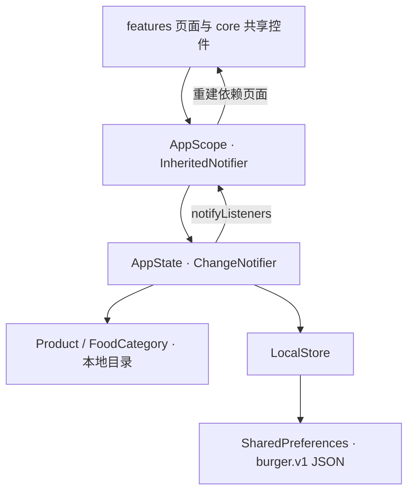

# Burger Flutter 项目结构与架构

## 项目范围

从 Pixso 当前打开的 **burger → xd page** 读取实现。原稿包含 21 个独立手机界面，基准宽度 375，常规高度 812；详情、结算和个人资料是可滚动长页。设计稿中的宣传展示板不属于 App 页面。

保留 `#000000 / #FEB500 / #FFFFFF` 配色、Poppins 字体、食物实拍素材、黑底黄色商品卡片、悬浮图片和四项底部导航。使用真实 Flutter 控件实现，页面不是整张设计图铺底。图片节点按 2 倍尺寸从 Pixso 导出；原稿页面截图另存用于对照。

## 目录结构

```text
burger/
├── lib/
│   ├── main.dart                      # 初始化本地存储、系统栏、启动 App
│   ├── app.dart                       # 应用入口、命名路由及页面装配
│   ├── core/
│   │   ├── routes.dart                # 统一路由常量，避免控件与页面循环依赖
│   │   ├── theme.dart                 # 颜色、字体、按钮和输入框主题
│   │   ├── widgets.dart               # 页面标题、导航、商品卡片等共享控件
│   │   └── validators.dart            # 邮箱、手机号、密码、卡号及有效期校验
│   ├── data/
│   │   ├── catalog.dart               # 商品模型、分类和本地商品目录
│   │   └── local_store.dart           # SharedPreferences JSON 存取
│   ├── state/
│   │   └── app_state.dart             # 购物车、收藏、资料、地址及偏好状态
│   └── features/
│       ├── onboarding/onboarding_page.dart   # 三张可滑动引导页
│       ├── auth/auth_page.dart               # 登录、注册、验证码及通知引导
│       ├── location/location_page.dart       # 参考地图、路线及位置确认
│       ├── shop/
│       │   ├── shop_pages.dart               # 首页、分类、商品列表、收藏
│       │   └── product_detail_page.dart      # 商品详情、收藏、评论
│       ├── cart/cart_pages.dart              # 购物车、结算及订单确认
│       └── account/account_pages.dart        # 资料、密码、配送及支付表单
├── assets/
│   ├── images/                        # 从 Pixso 导出的独立图片素材
│   └── fonts/                         # Poppins Regular / SemiBold 及 OFL 许可
├── test/                              # 业务状态、持久化与表单校验单元测试
├── integration_test/
│   ├── app_test.dart                   # Android 全页面截图与下单流程测试
│   └── responsive_suite.dart           # 两种尺寸布局与表单、导航回归检查
├── test_driver/screenshots.dart        # 把模拟器截图写入 docs/screenshots
├── docs/
│   ├── ARCHITECTURE.md                 # 本文
│   ├── SCREENS.md                      # 页面、原稿节点、路由及截图索引
│   ├── VALIDATION.md                   # 验证环境、结果及范围
│   ├── reference/                     # 21 张 Pixso 原稿图及节点快照
│   └── screenshots/                   # Flutter 实际运行截图
├── android/                           # Android 工程
├── ios/                               # iOS 工程
├── web/                               # Web 工程
└── pubspec.yaml / pubspec.lock         # 依赖声明与锁定版本
```

## 分层与数据流



- **展示层**按用户功能组织页面，负责布局、输入和导航。
- **状态层**集中维护购物车和用户数据，避免页面各存一份数量、价格或收藏。
- **数据层**封装商品目录与本地存储。页面不直接访问 SharedPreferences。
- **路由层**集中定义 `Routes`，通过 `MaterialPageRoute` 传入商品、分类和密码重置标记。底部导航切换时替换根路由，避免重复叠加页面。

采用 Flutter 自带的 `ChangeNotifier + InheritedNotifier`。本项目规模无需额外引入 Provider、Riverpod、Bloc 或路由库；共享表单和商品组件复用同一实现。

## 关键业务规则

### 购物车与结算

`Product.id` 是购物车唯一标识，数量为 1–99，减至 0 即移除。总金额始终由商品单价乘数量计算，使用整数美元避免浮点误差。商品卡片、详情、购物车、结算和底部角标共享状态。新安装默认空购物车；截图测试才会注入示例商品。

结算支持本地地址和支付方式选择。默认现金配送，添加演示卡后可选择卡片。提交生成演示订单编号，清空购物车，显示订单确认。订单和评论暂不做服务端持久化。

### 本地持久化

使用 `burger.v1` 一个版本化 JSON 保存资料、配送地址、通知偏好、引导完成标记、收藏、购物车以及支付卡尾号。写入排队执行，每次写入捕获独立快照，防止快速连续点击造成较旧数据覆盖较新数据。损坏 JSON 会回退到默认值，已移除的商品会被过滤。

不保存密码、验证码、完整卡号或 CVC。支付表单只保存卡号后四位、持卡人和有效期，提交后清空输入。删除本地账户会清空购物车、收藏和个人设置；退出保留本地资料。

### 表单与生命周期

邮箱、手机号和密码长度校验集中于 `Validate`。支付表单校验卡号 Luhn 校验和、`MM/YY` 格式、有效期及 CVC 位数。验证码支持焦点自动跳转、倒计时与重发入口，演示码为 `1234`。页面退出时释放输入控制器、焦点和计时器。

## 页面主流程

```text
三张引导页 ─→ 设置位置 ─→ 首页
      └─→ 登录邮箱 ─→ 密码 ─→ 首页
            ├─→ 注册 ─→ 手机号 ─→ 验证码 ─→ 通知偏好 ─→ 位置
            └─→ 忘记密码 ─→ 验证码 ─→ 重置密码

首页 / 分类 ─→ 商品列表 ─→ 商品详情 ─→ 加入购物车
购物车 ─→ 结算 ─→ 地址 / 演示支付卡 ─→ 本地订单确认
个人资料 ─→ 编辑资料 / 修改密码 / 配送地址 / 支付 / 偏好
```

## 适配与素材

主要内容按可用宽度布局，商品为双列网格，长页可滚动，输入页面在键盘弹出后仍可滚动。`SafeArea` 处理系统区域，桌面或 Web 预览限制内容最大宽度为 520。原稿中重叠的占位文字替换为可读的商品介绍，修正原稿拼写；保留主要视觉结构。

图片、字体均随应用打包，页面不依赖运行时网络图片或在线字体。`docs/reference/design_nodes.json` 保存本次读取到的节点、边界和文字，便于后续核对来源。地图使用原稿底图与绘制路线，属于静态 UI 演示。

## 后端接入边界

Android 发布配置见 `android/app/build.gradle.kts` 和 `android/app/proguard-rules.pro`。本地存储依赖通过 JNI 调用 Kotlin 方法，发布包保留该桥接代码及方法描述符中的类型，避免代码压缩改变运行时查找的签名。规则依据 [Android 官方 JNI 保留规则说明](https://developer.android.com/topic/performance/app-optimization/keep-rule-examples)。

目前交付的是可运行、可交互的 UI 演示 App：

| 能力 | 当前行为 | 后续接入点 |
| --- | --- | --- |
| 登录 / 注册 | 本地表单校验与导航 | 为 auth 增加认证服务与会话管理 |
| 验证码 | 本地演示码 `1234`，不发送短信或邮件 | 短信 / 邮件验证码服务 |
| 密码修改 | 校验新密码及确认值，提示演示结果 | 认证服务的修改 / 重置接口 |
| 社交登录 | 展示原稿入口，提示需配置认证服务 | Facebook / Google OAuth |
| 通知 / 定位 | 保存开关，静态地图选择与地址确认 | 原生权限、推送、地图及地理编码 |
| 支付 / 订单 | 演示卡尾号与本地订单，不扣款 | 支付 SDK token 化、订单 API |
| 语言 / 货币 | 与原稿一致的 English / USD | 国际化资源与定价服务 |

接入后端时优先在 `data/` 增加对应服务，把 `AppState` 的本地操作替换为异步调用；页面继续使用现有商品模型和公共组件。不要把认证凭证或完整卡资料写入当前偏好存储。
