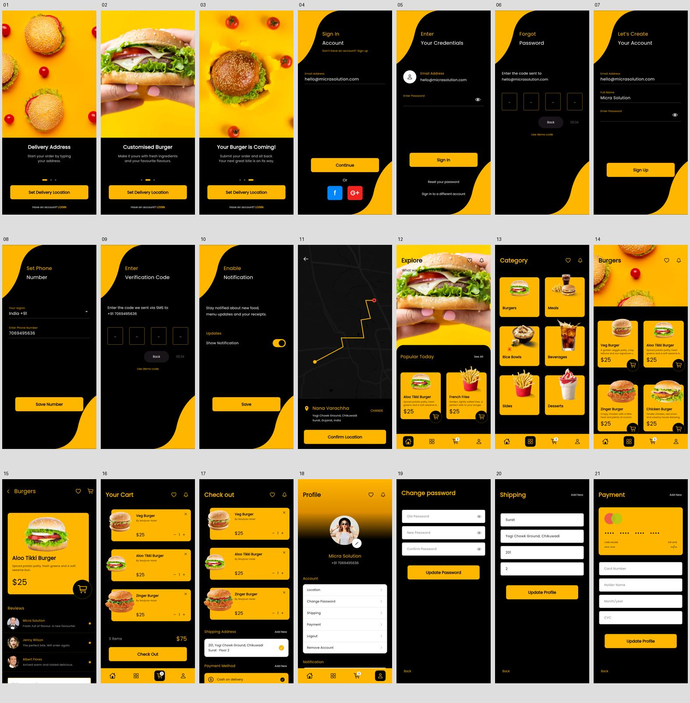

# 页面与截图索引

Pixso 原稿：`burger → xd page`。原稿导出在 `reference/`，Flutter 在 Android 模拟器中的实际截图在 `screenshots/`。它们分别保存，便于区分设计参考与实现结果。



| 序号 | 界面 | Pixso 节点 | App 路由 / 操作 | 原稿 | 实际截图 |
| --- | --- | --- | --- | --- | --- |
| 01 | 引导：配送地址 | `0:5` | `/welcome` | [原稿](reference/01.png) | [截图](screenshots/01-welcome-delivery.png) |
| 02 | 引导：定制汉堡 | `0:14` | `/welcome（向左滑动一次）` | [原稿](reference/02.png) | [截图](screenshots/02-welcome-customise.png) |
| 03 | 引导：等待配送 | `0:23` | `/welcome（向左滑动两次）` | [原稿](reference/03.png) | [截图](screenshots/03-welcome-coming.png) |
| 04 | 登录邮箱 | `0:32` | `/sign-in` | [原稿](reference/04.png) | [截图](screenshots/04-sign-in.png) |
| 05 | 登录密码 | `0:58` | `/password` | [原稿](reference/05.png) | [截图](screenshots/05-password.png) |
| 06 | 忘记密码 | `0:77` | `/forgot-password` | [原稿](reference/06.png) | [截图](screenshots/06-forgot-password.png) |
| 07 | 注册 | `0:93` | `/sign-up` | [原稿](reference/07.png) | [截图](screenshots/07-sign-up.png) |
| 08 | 设置手机号 | `0:113` | `/phone` | [原稿](reference/08.png) | [截图](screenshots/08-phone.png) |
| 09 | 验证码 | `0:131` | `/verify` | [原稿](reference/09.png) | [截图](screenshots/09-verification.png) |
| 10 | 通知设置 | `0:182` | `/notifications` | [原稿](reference/10.png) | [截图](screenshots/10-notifications.png) |
| 11 | 配送位置 | `0:232` | `/location` | [原稿](reference/11.png) | [截图](screenshots/11-location.png) |
| 12 | 首页 | `0:271` | `/home` | [原稿](reference/12.png) | [截图](screenshots/12-home.png) |
| 13 | 分类 | `0:364` | `/categories` | [原稿](reference/13.png) | [截图](screenshots/13-categories.png) |
| 14 | 商品列表 | `0:452` | `/products` | [原稿](reference/14.png) | [截图](screenshots/14-products.png) |
| 15 | 商品详情 | `0:589` | `/detail` | [原稿](reference/15.png) | [截图](screenshots/15-product-detail.png) |
| 16 | 购物车 | `0:654` | `/cart` | [原稿](reference/16.png) | [截图](screenshots/16-cart.png) |
| 17 | 结算 | `0:770` | `/checkout` | [原稿](reference/17.png) | [截图](screenshots/17-checkout.png) |
| 18 | 个人资料 | `0:937` | `/profile` | [原稿](reference/18.png) | [截图](screenshots/18-profile.png) |
| 19 | 修改密码 | `0:1032` | `/change-password` | [原稿](reference/19.png) | [截图](screenshots/19-change-password.png) |
| 20 | 配送地址 | `0:1045` | `/shipping` | [原稿](reference/20.png) | [截图](screenshots/20-shipping.png) |
| 21 | 支付卡 | `0:1065` | `/payment` | [原稿](reference/21.png) | [截图](screenshots/21-payment.png) |

## 长页面补充

详情、结算和资料页支持滚动，另提供下半部分截图：

- [商品详情下半部分](screenshots/15-product-detail-bottom.png)
- [结算下半部分](screenshots/17-checkout-bottom.png)
- [个人资料下半部分](screenshots/18-profile-bottom.png)

## 交互状态补充

- [演示下单成功](screenshots/22-order-confirmation.png)
- [购物车空状态](screenshots/23-empty-cart.png)

## 重新生成截图

连接 Android 模拟器后，在项目根目录执行：

```powershell
flutter drive --driver=test_driver/screenshots.dart --target=integration_test/app_test.dart -d emulator-5554 --enable-software-rendering --no-enable-impeller
```

截图测试先进行两种尺寸的页面布局检查与表单、导航回归检查，再逐页运行实际 Flutter 页面，滑动三张引导页和长页面，最后完成分类浏览 → 商品详情 → 收藏 → 加购 → 调整数量 → 添加演示支付卡 → 结算 → 下单确认的操作。测试注入独立演示数据，不依赖真实账户或在线服务。

